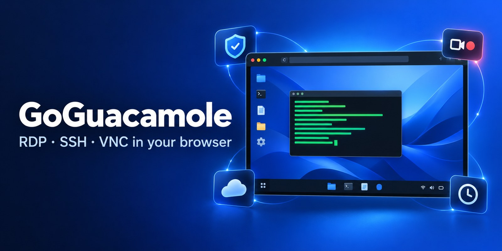
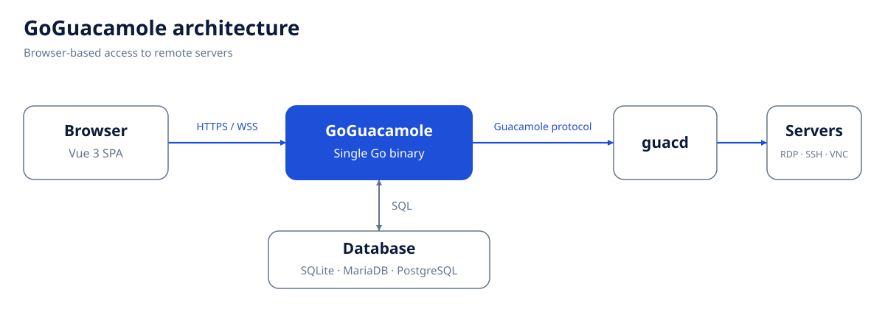
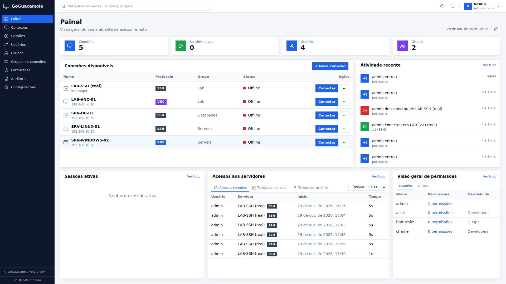
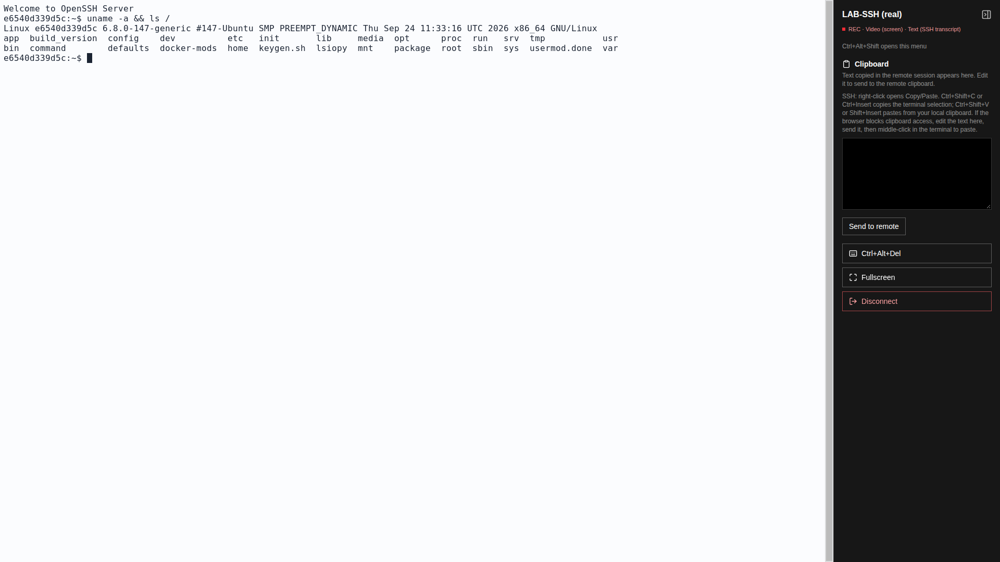
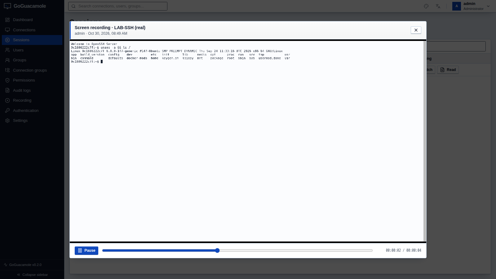
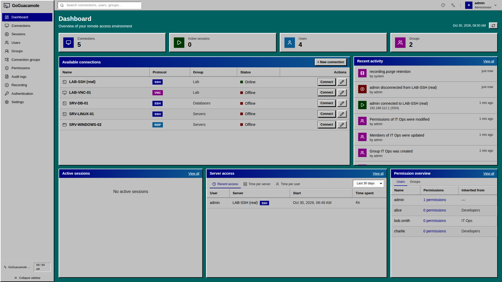

<p align="center">
  
</p>

<p align="center">
  <a href="https://github.com/jniltinho/go-guacamole/releases/latest"></a>
  <a href="https://github.com/jniltinho/go-guacamole/actions/workflows/ci.yml"></a>
  <a href="LICENSE"></a>
  <a href="https://github.com/jniltinho/go-guacamole/pkgs/container/go-guacamole"></a>
</p>

# GoGuacamole

**Browser-based RDP, SSH and VNC for your team, with session recording, audit logging and single sign-on.**

A self-hosted, MIT-licensed Go alternative to the Java `guacamole-client`, with an embedded Vue 3 interface and the
same Apache Guacamole **guacd** backend. It ships as one binary and imports your existing Guacamole database.

<p align="center">
  
</p>

## Why use GoGuacamole?

- **Nothing to install for users**: a browser tab, no VPN client, no RDP/SSH client.
- **Recording and audit**: policy-controlled session recording, playback in the browser, SSH transcripts you can
  search, retention, legal hold, and storage in your own S3, Oracle Cloud or Google Cloud bucket.
- **Built-in access controls**: configurable SSO (OIDC, SAML, LDAP/AD) and MFA (TOTP, Duo), encrypted stored
  credentials, and live sessions closed when access is revoked.
- **Easy to run**: SQLite to start, MariaDB or PostgreSQL to grow; one container for a single host.
- **Pleasant to use**: 16 themes, English and Português (Brasil).

## Quick start

```bash
git clone https://github.com/jniltinho/go-guacamole.git && cd go-guacamole/docker
docker compose up -d --build
docker compose logs goguacamole | grep 'bootstrap administrator'   # generated admin password
```

Open <http://localhost:8080>, sign in as `admin`, and create an SSH, RDP or VNC connection to a server that guacd can
reach. This HTTP setup is for local evaluation: follow the [production checklist](docs/security.md#production-checklist)
before going live. Other ways to run it: [docs/README.md](docs/README.md#getting-started).

Coming from Apache Guacamole? `goguacamole import guacamole --source-driver mysql --dsn '...' --dry-run` reads your
database without changing it; users keep their passwords.
[How the import works](docs/operations.md#importing-from-apache-guacamole).

## Screenshots

| Dashboard | SSH session |
|---|---|
|  |  |
| **Recording playback** | **Windows 98 theme** |
|  |  |

## Documentation

See the **[documentation](docs/README.md)** for features, deployment, configuration and operations.

## License

[MIT](LICENSE); third-party attributions in [NOTICE](NOTICE). Apache Guacamole and guacd are projects of the Apache
Software Foundation; GoGuacamole is an independent project.
