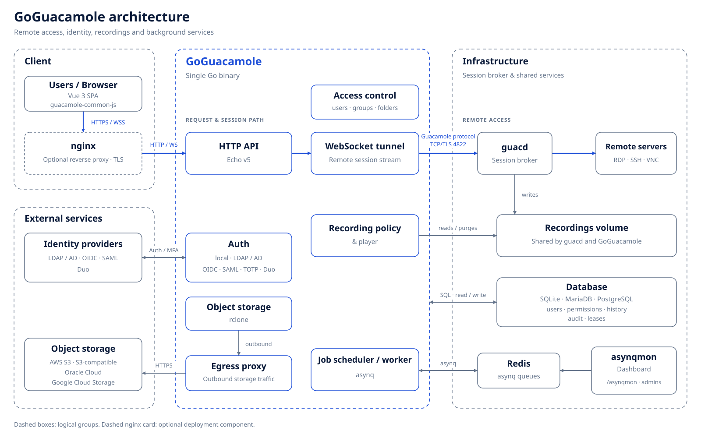

# GoGuacamole documentation

GoGuacamole is a web gateway for Apache Guacamole's **guacd**: RDP, SSH and VNC in the browser, with users, groups,
permissions, session recording and audit. It is written in Go (Echo v5, Cobra) with an embedded Vue 3 interface (Vite+,
Tailwind CSS v4) and replaces the Java `guacamole-client`.

<p align="center">
  <a href="images/architecture-detailed.svg"></a>
</p>
<p align="center"><a href="images/architecture-detailed.svg">Open the full-size architecture diagram</a></p>

| Guide | What it covers |
|---|---|
| [Architecture](architecture.md) | components, how a session opens, access control, data model, background jobs, limits |
| [Configuration](configuration.md) | configuration keys, environment variables and default values |
| [Operations](operations.md) | first start, backups, upgrades, import, TLS, recording policy, job queue, object storage, troubleshooting |
| [Security](security.md) | model, controls, recording and data protection (LGPD), production checklist |
| [REST API](api.md) | `/api/v1` endpoints, permissions, errors, tunnel status codes, `/asynqmon` |
| [All-in-one image](all-in-one.md) | one container with guacd, goguacamole and Redis: build, from the latest release, run, options |
| [Docker folder](../docker/README.md) | the all-in-one Compose project, MariaDB/PostgreSQL, nginx in front |
| [Themes](../frontend/src/themes/README.md) | theme structure and how to add a theme |
| [Roadmap](../ROADMAP.md) | what is missing or worth improving |

## Features

| Area | What you get |
|---|---|
| **Remote access** | RDP, SSH and VNC; clipboard, resize and audio; file transfer (SFTP, RDP drive, drag-and-drop upload); SSH color schemes, fonts, scrollback, terminal settings and SFTP |
| **Identity** | local users and groups; LDAP / Active Directory, OpenID Connect (code + PKCE), SAML 2.0, a trusted-proxy header and encrypted JSON links (guacamole-auth-json compatible); TOTP and Duo Universal Prompt for password sign-ins; configured in **Administration → Authentication**, with connection tests for external providers |
| **Access control** | permissions per user and group, inherited through connection folders; connection limits; account validity and access windows; revoking access closes live sessions |
| **Recording & audit** | screen recording (RDP, SSH, VNC), SSH transcripts, optional keystrokes; in-browser player; recording policy per connection; retention per kind; legal hold; fail-closed launches; audit log of sign-ins, sessions and administrative changes made through the UI and API |
| **Object storage** | AWS S3, S3-compatible (MinIO, Ceph, R2, Wasabi…), Oracle Cloud, Google Cloud Storage; verified uploads, optional local removal, playback from the bucket, retention cleanup including S3 object versions (provider and object-lock limits apply) |
| **Operations** | SQLite, MariaDB/MySQL or PostgreSQL; automatic migrations; background jobs on Redis (asynq) with the asynqmon dashboard; `/health` and `/ready`; structured logs; native HTTPS; container images |
| **Interface** | 16 themes (Light, Dark, NOC, Dracula, Bionexo, Matrix, xterm, macOS, Ubuntu, KDE, Google, High contrast, Windows 11/XP/98, Mac OS retro); English and Português (Brasil); keyboard search |
| **Migration** | read-only importer from an Apache Guacamole MySQL/PostgreSQL database; imported local passwords keep working; differences in effective access are reported for review |

## Compared with the Java client

| | Apache `guacamole-client` | GoGuacamole |
|---|---|---|
| Runtime | Java, Tomcat and extensions | one Go binary with the UI embedded |
| Database | MySQL, PostgreSQL or SQL Server through a JDBC extension | SQLite, MariaDB/MySQL or PostgreSQL built in |
| SSO and MFA | separate extensions, configured in files | built in, configured and tested from the UI |
| Session recording | recordings on disk; in-browser playback through the recording-storage extension | in-browser player built in, SSH transcripts, retention, legal hold, object storage |
| Upgrades | redeploy the WAR and extensions | replace the binary or image; migrations run on start |
| guacd | `guacamole/guacd` | the same `guacamole/guacd` (1.6) |

Not built in yet: session sharing (joining an active session), balancing groups, horizontal scaling of tunnels and MFA
on top of SSO sign-ins (enforce it at your identity provider) — see
[architecture](architecture.md#topology-and-limits) and the [roadmap](../ROADMAP.md).

## Getting started

### All-in-one (one container)

```bash
git clone https://github.com/jniltinho/go-guacamole.git && cd go-guacamole/docker
docker compose up -d --build
docker compose logs goguacamole | grep 'bootstrap administrator'   # generated admin password, printed once
```

guacd, goguacamole and Redis in one container; SQLite, recordings and RDP drives in `docker/data`. Details:
[all-in-one.md](all-in-one.md).

No build at all: `docker compose -f compose.release.yml up -d --build` (in `docker/`) makes the same container from
the latest release in seconds ([details](all-in-one.md#from-the-latest-release-fast-no-build)).

### Docker Compose (separate services)

```bash
git clone https://github.com/jniltinho/go-guacamole.git && cd go-guacamole
cp .env.example .env     # set APP_ADMIN_PASSWORD (8+ chars) and APP_SECRET_KEY (openssl rand -hex 32)
make up                  # app + guacd + Redis, SQLite volume → http://localhost:8080
```

| Command | What it starts |
|---|---|
| `make up` | app + guacd + Redis, SQLite |
| `make up-mariadb` | + MariaDB 11.4 |
| `make up-postgres` | + PostgreSQL 17 |
| `make up-lab` | + SSH / VNC / RDP test servers (`ssh-target:2222`, `vnc-target:5901`, `rdp-target:3389`) |
| `make certs up-tls` | native HTTPS on `https://localhost:8443` with a local CA |
| `make down` | stop everything |

Without `APP_ADMIN_PASSWORD` a random password is printed once: `docker compose logs app | grep bootstrap`.

### Container image

Prebuilt binaries and the regular image target Linux/amd64; for other architectures build from source (see
[all-in-one.md](all-in-one.md#building-the-image) for Buildx).

```bash
docker network create guac
docker run -d --name guacd --network guac guacamole/guacd:1.6.0
docker run -d --name redis --network guac redis:7-alpine          # optional: job queue and object storage
docker run -d --name goguacamole --network guac -p 8080:8080 -v gg-data:/data \
  -e APP_ADMIN_PASSWORD='change-me-now' -e REDIS_ADDR=redis:6379 ghcr.io/jniltinho/go-guacamole:latest
```

These minimal examples leave session recording off. For recording and object storage, use the Compose stack, or share
a recordings volume between guacd and goguacamole and enable recording ([operations](operations.md#session-recording)).

### Binary

Download it (Linux/amd64) from [Releases](https://github.com/jniltinho/go-guacamole/releases), or build it:

```bash
make build                                   # frontend (→ web/dist) + Go binary (bin/goguacamole)
docker run -d -p 127.0.0.1:4822:4822 guacamole/guacd:1.6.0
APP_ADMIN_PASSWORD='change-me-now' GUACD_ADDR=127.0.0.1:4822 ./bin/goguacamole serve
```

Sign in as `admin`; you are asked to choose a new password. Production setup (HTTPS, proxy, secret key, backups):
[security checklist](security.md#production-checklist).

## Migrating from Apache Guacamole

```bash
# read-only: the source database is never modified
goguacamole import guacamole --source-driver mysql \
  --dsn 'guacamole_user:pass@tcp(old-db:3306)/guacamole_db' --dry-run
goguacamole import guacamole --source-driver mysql --dsn '...'
```

What is imported, what is not, and how access is compared: [operations](operations.md#importing-from-apache-guacamole).

## Recordings in object storage

1. Run with Redis (`REDIS_ADDR`; Compose and the all-in-one image include it).
2. **Administration → Recording → Object storage**: provider, bucket, credentials → **Test access** (write, read
   back, delete; reports versioning and object lock) → enable uploads → **Save**.
3. Optionally turn off *keep local copy* and click **Upload existing recordings**.

Private or plain-HTTP endpoints (a lab MinIO) must be allowed: `OBJSTORE_ALLOWED_ENDPOINTS=minio`,
`OBJSTORE_ALLOW_HTTP=true`. Providers, permissions, versioning and object lock:
[operations](operations.md#recording-storage-object-storage).

## CLI

```
goguacamole serve                       start the HTTP(S) server
goguacamole migrate up|down|status      database migrations
goguacamole user create|passwd|list|disable
goguacamole import guacamole            import from an Apache Guacamole database
goguacamole config print                effective configuration (secrets redacted)
goguacamole healthcheck                 used by the Docker HEALTHCHECK
goguacamole version
```

Configuration comes from `config.toml` ([example](../config.toml.example)) and environment variables (`APP_*`, `TLS_*`,
`DB_*`, `GUACD_*`, `AUDIT_*`, `RECORDING_*`, `REDIS_*`, `JOBS_*`, `OBJSTORE_*`): [configuration](configuration.md).

## Development

```bash
make deps
make dev-backend      # terminal 1: Go API on :8080; start guacd as in "Binary" above (127.0.0.1:4822)
make dev-frontend     # terminal 2: Vite+ on :9000, proxies /api and the WebSocket to :8080
make test             # Go + frontend unit tests
make test-db          # repository tests on MariaDB and PostgreSQL containers
make lint             # go vet, gofmt, vp check
make e2e              # API/tunnel e2e on 3 databases, object storage, Playwright browser and theme suites (Docker)
./deploy/e2e.sh storage   # object storage only: PostgreSQL + Redis + S3 with versioning
make screenshots      # regenerate docs/screenshots
```

Layout: `main.go` (embeds `web/dist`), `cmd/` (Cobra commands), `internal/` (config, guac protocol, tunnel, store,
auth, access, importer, jobs, objstore, server), `frontend/` (Vue app), `e2e/`, `deploy/`, `docker/`, `docs/`,
`openspec/` (specs and changes).

## Diagrams

| Simple | Detailed |
|---|---|
| [SVG](images/architecture-simple.svg) · [PNG](images/architecture-simple.png) | [SVG](images/architecture-detailed.svg) · [PNG](images/architecture-detailed.png) |
