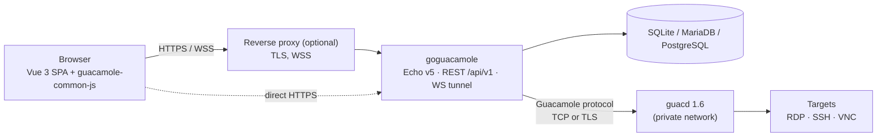
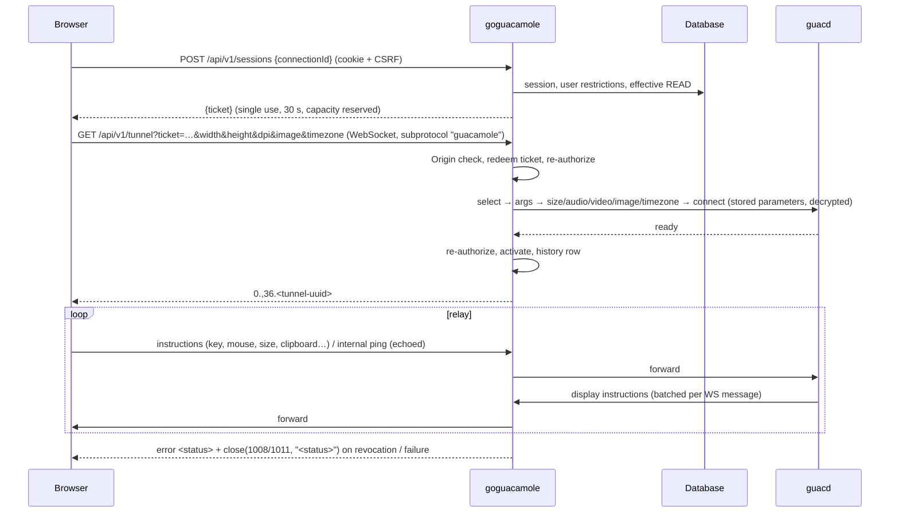

# Architecture

GoGuacamole is a single Go binary that serves the REST API, the WebSocket tunnel and the embedded Vue SPA, and talks
the Guacamole protocol directly to `guacd`. It replaces the Apache Guacamole Java web application.

## Components

| Package | Responsibility |
|---|---|
| `main.go` | entry point, embeds `web/dist` (the built SPA) |
| `cmd/` | Cobra commands: `serve`, `migrate`, `user`, `import`, `config`, `healthcheck`, `version` |
| `internal/config` | typed configuration, TOML + env + flags (Viper), validation |
| `internal/guac` | Guacamole protocol: instruction codec (code-point lengths), streaming reader, guacd dial (TCP/TLS), handshake, status codes |
| `internal/tunnel` | launch tickets, registry of reservations/tunnels (limits, revocation, kill), WebSocket ⇄ guacd relay |
| `internal/store` | `database/sql` repositories for the 3 drivers (dialect: placeholder rebind, insert ids), embedded migrations |
| `internal/secrets` | registry of secret connection parameters, AES-256-GCM box |
| `internal/auth` | bcrypt + legacy Guacamole SHA-256 hashes, account restrictions (validity, access windows), rate limiter |
| `internal/access` | effective permissions (direct + groups + inherited folders), authorization helpers |
| `internal/importer` | read-only import from an Apache Guacamole JDBC database |
| `internal/server` | Echo app: middleware, handlers, enforcer (revocation / expiry), prober, SPA serving |
| `frontend/` | Vue 3 + TS, Vue Router, Pinia, vue-i18n (en, pt-BR), Tailwind v4, themes |

## Opening a remote session

Connection parameters (host, credentials) never come from the browser; only display parameters do.

## Access control

- System permissions: `ADMINISTER`, `CREATE_CONNECTION`, `CREATE_USER`, `AUDIT`.
- `READ` on a connection, or on a connection group (inheritable: all current and future connections inside).
- Grants to users or to (flat) user groups; disabled groups grant nothing.
- Every handler and tunnel launch checks effective permissions; invisible resources return 404.
- Any change that may reduce access (grant removal, membership, group disable, moves, deletes, user disable/password
  reset) re-evaluates open tunnels synchronously; changes made by other processes (CLI, importer) are picked up within
  5 s through `users.security_stamp` and `system_state.access_epoch`.

## Data model

`users`, `user_groups`, `user_group_members`, `connection_groups` (tree), `connections`, `connection_parameters`
(secrets encrypted), `system_permissions`, `connection_permissions`, `connection_group_permissions`, `favorites`,
`app_sessions` (token hash, CSRF token), `preferences`, `connection_history` and `audit_events` (name snapshots,
references set NULL on delete), `system_state`, `schema_migrations`. Timestamps are Unix milliseconds.

## Topology and limits

The tunnel registry, connection limits and session kills are process-local: run a single replica (scale vertically).
SQLite is fine for small/medium installs; use MariaDB/PostgreSQL for larger ones.
